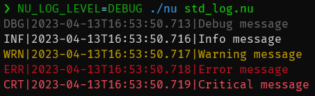

# Stdout, Stderr, and Exit Codes

An important piece of interop between Nushell and external commands is working with the standard streams of data coming from the external.

The first of these important streams is stdout.

## Stdout

Stdout is the way that most external apps will send data into the pipeline or to the screen. Data sent by an external app to its stdout is received by Nushell by default if it's part of a pipeline:

```nu
nu -c 'print hello' | str uppercase
# => HELLO
```

The above calls `nu` as an external command and redirects its stdout output stream into the pipeline. With this redirection, Nushell can then pass the data to the next command in the pipeline, here [`str uppercase`](/commands/docs/str_uppercase.md).

Without the pipeline, Nushell will not do any redirection, allowing it to print directly to the screen.

## Stderr

Another common stream that external applications often use to print error messages is stderr. By default, Nushell does not do any redirection of stderr, which means that by default it will print to the screen.

But you can pass stderr to a command or a file if you want to:

- use `e>|` to pass stderr to next command.
- use `e> file` to redirect stderr to a file.
- use `cmd | complete` to capture the stderr message along with stdout and the exit code.

You may see `do -i { cmd } | complete` in older scripts. The `do -i` isn't needed there, and it doesn't make a failing external harmless in general. When the output of `do -i` goes to `let` or into a pipe, as in `do -i { ^false } | lines`, the failure still stops the pipeline. See the [`do --ignore-errors` note](/lang-guide/chapters/flow_control/try-catch.md#language-notes) for the full rules.

## Exit Code

Finally, external commands have an "exit code". These codes help give a hint to the caller whether the command ran successfully.

Nushell tracks the last exit code of the recently completed external in one of two ways. The first way is with the `LAST_EXIT_CODE` environment variable.

```nu
nu -c 'print "something went wrong"; exit 3'
# => something went wrong
$env.LAST_EXIT_CODE
# => 3
```

The second way is to use the [`complete`](/commands/docs/complete.md) command.

A non-zero exit code is treated as an error. In a script, execution stops at the failing command, and the lines after it do not run. (In the REPL, type `$env.LAST_EXIT_CODE` on its own line after the failing command, as above.)

Nushell doesn't print an error message of its own for a non-zero exit code. You only see what the command printed. Set `$env.config.display_errors.exit_code` to `true` to also get a Nushell error that points at the failing command. The [`try` section of Control Flow](./control_flow.md#try) explains both `display_errors` settings and what a script prints when it stops this way:

```nu
^cat unknown.txt
# => cat: unknown.txt: No such file or directory
$env.config.display_errors.exit_code = true
^cat unknown.txt
# => cat: unknown.txt: No such file or directory
# => Error: nu::shell::non_zero_exit_code
# =>
# =>   × External command had a non-zero exit code
# =>    ╭─[repl_entry #3:1:2]
# =>  1 │ ^cat unknown.txt
# =>    ·  ─┬─
# =>    ·   ╰── exited with code 1
# =>    ╰────
```

On Unix-like systems, a command that is stopped by a signal gets a "terminated by a signal" error, which names the signal. Set `$env.config.display_errors.termination_signal` to `false` to hide it. A core dump is always reported. These two settings only control the message. The command fails either way, and `$env.LAST_EXIT_CODE` is set either way.

SIGPIPE never counts as a failure. A command receives it when it writes to a pipe that the next command has stopped reading, as `yes` does in `^yes | ^head -n 1`. That pipeline succeeds, and `$env.LAST_EXIT_CODE` is `0`.

This also applies to externals in the middle of a pipeline: if _any_ external command in a pipeline fails, the whole pipeline fails, even when the commands after it succeed (similar to `set -o pipefail` in Bash). `$env.LAST_EXIT_CODE` is then set to the exit code of the rightmost command that failed. To handle a failure yourself, use [`try`](/commands/docs/try.md), whose `catch` closure receives an error record with an `exit_code` field, or capture the exit code with `complete`:

```nu
try { ^false | lines } catch {|err| $err.exit_code }
# => 1
```

::: tip
This pipeline behavior is an opt-out experimental option named `pipefail`. To turn it off, start Nushell with `nu --experimental-options '[pipefail=false]'`. [Experimental options](./configuration.md#experimental-options) lists the other ways to set it.

With `pipefail` off, only the last command of a pipeline decides whether the pipeline fails. `^false | ^cat` succeeds, `try` has nothing to catch, and `$env.LAST_EXIT_CODE` is `0`, the exit code of `cat`. When the last command is a Nushell command, as in `^false | lines`, the failure is ignored and `$env.LAST_EXIT_CODE` keeps the value it had before.
:::

### Nushell's own exit status

When a script (`nu script.nu`) or a command string (`nu -c '...'`) stops at an error that nothing catches, Nushell prints the error and exits with a non-zero status. The status tells the calling program what failed:

- `1` for an error from Nushell itself, such as a parse error, a failing built-in command, or [`error make`](/commands/docs/error_make.md).
- The external command's own exit code when an external failed. A script that stops at an external that exited with `42` exits with `42`.
- `256 - N` when an external was killed by signal `N`. This only happens on Unix-like systems. Inside Nushell, [`complete`](/commands/docs/complete.md) and the `exit_code` field of a `catch` error report the signal as `-N`, and the operating system keeps only the low 8 bits of that, so SIGTERM (15) becomes `241`. Bash reports `128 + N` (`143` for SIGTERM) in the same situation.

```nu
nu -c 'error make {msg: boom}' | complete | get exit_code
# => 1
nu -c 'nu -c "exit 42"' | complete | get exit_code
# => 42
sh -c 'kill -TERM $$' | complete | get exit_code
# => -15
nu -c 'sh -c "kill -TERM $$"' | complete | get exit_code
# => 241
```

A flag that `nu` doesn't accept also gives `1`, and nothing runs (see [Passing flags to `nu`](./configuration.md#passing-flags-to-nu)).

To set the status yourself, call [`exit`](/commands/docs/exit.md). Without an argument, `exit` gives `0`. With one, as in `exit 3`, it gives that number. On Unix-like systems only the low 8 bits are kept, so `exit 300` gives `44` and `exit -1` gives `255`.

`exit` is not an error, so `try` doesn't stop it. A `catch` block never runs for `exit`, but a `finally` block does, and then Nushell exits with the code you gave:

```nu
nu -c 'try { exit 4 } catch { print caught } finally { print cleanup }; print after' | complete
# => ╭───────────┬─────────╮
# => │ stdout    │ cleanup │
# => │           │         │
# => │ stderr    │         │
# => │ exit_code │ 4       │
# => ╰───────────┴─────────╯
```

`exit --abort` skips the `finally` blocks too.

### Interrupting with Ctrl+C

Pressing <kbd>Ctrl</kbd>+<kbd>C</kbd> while Nushell code runs raises an `Operation interrupted` error. Loops, streams, and long-running commands such as [`sleep`](/commands/docs/sleep.md) check for it as they go, so the error points at the command that was running when you pressed the keys:

```nu
for i in 1.. { sleep 100ms }
# => Error: nu::shell::error
# =>
# =>   × Operation interrupted
# =>    ╭─[repl_entry #1:1:16]
# =>  1 │ for i in 1.. { sleep 100ms }
# =>    ·                ──┬──
# =>    ·                  ╰── This operation was interrupted
# =>    ╰────
```

Like any other error, it stops a script, and `try` can catch it. The `catch` block runs normally, even though you just pressed <kbd>Ctrl</kbd>+<kbd>C</kbd>:

```nu
try { sleep 1min } catch {|err| $err.msg }
# => Operation interrupted
```

An external command gets the keypress itself, as the SIGINT signal. In the REPL on Unix-like systems, the command runs as the terminal's foreground job, so the signal goes to it and not to Nushell. Most commands stop when they get it, and Nushell then reports the signal as it does for any command that a signal stops:

```nu
^sleep 60
# => Error: nu::shell::terminated_by_signal
# =>
# =>   × External command was terminated by a signal
# =>    ╭─[repl_entry #1:1:2]
# =>  1 │ ^sleep 60
# =>    ·  ──┬──
# =>    ·    ╰── terminated by SIGINT (2)
# =>    ╰────
$env.LAST_EXIT_CODE
# => -2
```

When a script runs an external command, <kbd>Ctrl</kbd>+<kbd>C</kbd> reaches Nushell as well. If the external catches the signal and exits normally, the script still stops, with `Operation interrupted` at its next command.

## Using the [`complete`](/commands/docs/complete.md) command

The [`complete`](/commands/docs/complete.md) command allows you to run an external to completion, and gather the stdout, stderr, and exit code together in one record.

If we try to run the external `cat` on a file that doesn't exist, we can see what [`complete`](/commands/docs/complete.md) does with the streams, including the redirected stderr:

```nu
cat unknown.txt | complete
# => ╭───────────┬─────────────────────────────────────────────╮
# => │ stdout    │                                             │
# => │ stderr    │ cat: unknown.txt: No such file or directory │
# => │           │                                             │
# => │ exit_code │ 1                                           │
# => ╰───────────┴─────────────────────────────────────────────╯
```

The `stderr` value ends with a newline, which is why the table shows an empty line after the message.

`stdout` and `stderr` are strings when the output is valid UTF-8. When it isn't, the field holds the bytes as a `binary` value:

```nu
^printf '\377\376' | complete | describe
# => record<stdout: binary, stderr: string, exit_code: int>
```

`complete` only takes the output of an external command. Anything else is an error:

```nu
ls | complete
# => Error: nu::shell::error
# =>
# =>   × Complete only works with external commands
# =>    ╭─[repl_entry #1:1:6]
# =>  1 │ ls | complete
# =>    ·      ────┬───
# =>    ·          ╰── complete only works on external commands
# =>    ╰────
```

`complete` doesn't change `$env.LAST_EXIT_CODE`. A failing command's exit code is only in the record.

## `echo`, `print`, and `log` commands

The [`echo`](/commands/docs/echo.md) command is mainly for _pipes_. It returns its arguments, ignoring the piped-in value. There is usually little reason to use this over just writing the values as-is.

In contrast, the [`print`](/commands/docs/print.md) command prints the given values to stdout, or to stderr with `--stderr` (`-e`). Unlike [`echo`](/commands/docs/echo.md), this command does not return any value (`print | describe` will return "nothing"). Since this command has no output, there is no point in piping it with other commands.

`print` prints each argument on its own line and shows structured values as tables, the way the REPL shows a result. `--no-newline` (`-n`) leaves out the line ending. Pipeline input is printed only when there are no arguments:

```nu
print a [1 2]
# => a
# => ╭───┬───╮
# => │ 0 │ 1 │
# => │ 1 │ 2 │
# => ╰───┴───╯
"piped" | print "argument"
# => argument
```

`--raw` (`-r`) skips the tables. A list prints one item per line, and other values print as text. Binary data goes out as the bytes themselves, with no line ending added, so `0x[41 42 43] | print --raw` prints `ABC`.

`print` writes straight to Nushell's own stdout or stderr, so a [file redirection](#file-redirections) doesn't capture it. `print -e oops e> err.log` still shows `oops` on the screen and leaves `err.log` empty. To get text into a file, return it as a value and redirect or [`save`](/commands/docs/save.md) that.

The [standard library](/book/standard_library.md) has commands to write out messages in different logging levels. For example:

@[code](@snippets/book/std_log.nu)



The log level for output can be set with the [`NU_LOG_LEVEL`](/book/special_variables.md#env-nu-log-level) environment variable:

```nu
NU_LOG_LEVEL=DEBUG nu std_log.nu
```

Every `log` command writes to stderr, so its messages stay out of the pipeline and out of a file redirected with `o>`. [`std/log`](./standard_library/log.md) describes the format of a log line and the `--short`, `--format`, and `--context` flags.

## File Redirections

If you want to redirect stdout of an external command to a file, you can use `out>` followed by a file path. Similarly, you can use `err>` to redirect stderr:

```nu
cat unknown.txt out> out.log err> err.log
```

If you want to redirect both stdout and stderr to the same file, you can use `out+err>`:

```nu
cat unknown.txt out+err> log.log
```

Note that `out` can be shortened to just `o`, and `err` can be shortened to just `e`. So, the following examples are equivalent to the previous ones above:
```nu
cat unknown.txt o> out.log e> err.log

cat unknown.txt o+e> log.log
```

Use `o+e>` to get both streams in one file. Naming the same file twice, as in `o> log.log e> log.log`, opens it twice, and the two streams write over each other's text instead of taking turns.

The `>` forms replace the file's contents. To add to the end of the file instead, use `>>`. Both forms create the file if it doesn't exist yet:

```nu
nu -c 'print one' o> out.log
nu -c 'print two' o>> out.log
open out.log
# => one
# => two
```

The combined forms can name the streams in either order, so `e+o>` and `err+out>` do the same as `o+e>`. This table lists every redirection operator, including the [pipe redirections](#pipe-redirections) described below:

| Operators                                         | Effect                                           |
| ------------------------------------------------- | ------------------------------------------------ |
| `o>`, `out>`                                      | Write stdout to a file, replacing its contents   |
| `o>>`, `out>>`                                    | Append stdout to a file                          |
| `e>`, `err>`                                      | Write stderr to a file, replacing its contents   |
| `e>>`, `err>>`                                    | Append stderr to a file                          |
| `o+e>`, `out+err>`, `e+o>`, `err+out>`            | Write both streams to one file                   |
| `o+e>>`, `out+err>>`, `e+o>>`, `err+out>>`        | Append both streams to one file                  |
| `e>\|`, `err>\|`                                  | Pipe stderr to the next command                  |
| `o+e>\|`, `out+err>\|`, `e+o>\|`, `err+out>\|`    | Pipe both streams to the next command            |

Also, any expression can be used for the file path, as long as it is a string value:
```nu
use std
cat unknown.txt o+e> (std null-device)
```

`std null-device` returns the system's null device, `/dev/null`, or `\\.\NUL` on Windows, so this example throws both streams away. After `use std/util *`, the same command is available as `null-device`. `std/util` also exports the path as a constant, `null_device`, for places where Nushell needs the value while it parses your code, such as a parameter's default value (see [`null-device` and `null_device`](./standard_library/util.md#null-device-and-null-device)).

A path that isn't a string, such as the number in `o> (1 + 1)`, is a `cant_convert` error. A leading `~` in the path expands to your home directory, and a relative path starts from the current directory. The path is never treated as a glob, so `o> *.log` writes to a file named `*.log`. The directory has to exist already. A path such as `missing/out.log` fails with a `not_found` error.

Semicolons follow defined pipeline behavior. In the following example, the first external command prints to stdout, and the second external command stdout becomes the output of the parentheses-subexpression and gets piped into `test.txt`.
```nu
(nu -c 'print hello'; nu -c 'print world') o> test.txt
# => hello
open test.txt
# => world
```

To combine the output, scope them into a block and execute it with `do`:
```nu
let text = "hello\nworld"
do { $text | head -n 1; $text | tail -n 1 } o> out.txt
open out.txt
# => hello
# => world
```

This external command behavior is in contrast to native Nushell expressions where the first command's stdout gets discarded:
```nu
('hello'; 'world') o> test.txt
open test.txt
# => world
```

When the redirected command is a Nushell command, its result is written to the file as text. A string or a number is written as it is, binary data as the bytes themselves, and a list one item per line. A record, a table, or a list inside a list can't be written this way. Convert it first, for example with [`to json`](/commands/docs/to_json.md):

```nu
[a b c] o> list.txt
open list.txt
# => a
# => b
# => c
{name: nu} o> record.txt
# => Error: nu::shell::cant_convert
# =>
# =>   × Can't convert to string.
# =>    ╭─[repl_entry #3:1:1]
# =>  1 │ {name: nu} o> record.txt
# =>    · ─────┬────
# =>    ·      ╰── can't convert record<name: string> to string
# =>    ╰────
```

`e>` only collects the stderr of external commands. A Nushell command returns no stderr stream, so `e>` on one leaves an empty file. That includes `print -e`, which [writes straight to the screen](#echo-print-and-log-commands).

## Pipe Redirections

If a regular pipe `|` comes after an external command, it redirects the stdout of the external command as input to the next command. To instead redirect the stderr of the external command, you can use the stderr pipe, `err>|` or `e>|`:

```nu
nu -c 'print -e error' e>| str uppercase
# => ERROR
```

Of course, there is a corresponding pipe for combined stdout and stderr, `out+err>|` or `o+e>|`:

```nu
nu -c 'print output; print -e error' o+e>| str uppercase
# => OUTPUT
# => ERROR
```

There is no pipe redirection for stdout alone, since a plain `|` already does that job. `o>|` and `out>|` are parse errors:

```nu
nu -c 'print hello' o>| str uppercase
# => Error: nu::parser::parse_mismatch
# =>
# =>   × Parse mismatch: expected `|`.  Redirecting stdout to a pipe is the same as
# =>   │ normal piping..
# =>    ╭─[repl_entry #1:1:21]
# =>  1 │ nu -c 'print hello' o>| str uppercase
# =>    ·                     ─┬─
# =>    ·                      ╰── expected `|`.  Redirecting stdout to a pipe is the same as normal piping.
# =>    ╰────
# =>   help: Check the syntax around this position — a typo, missing delimiter, or
# =>         wrong separator is common.
```

::: note
Because a failing external makes the whole pipeline fail (see [Exit Code](#exit-code)), the redirected output of a command that exits with an error can be lost. For example, `cat unknown.txt e>| str uppercase` prints nothing, because `cat` exits with code 1. Use [`complete`](#using-the-complete-command) when you need both the output and the exit code of a failing command.
:::

Unlike file redirections, pipe redirections do not apply to all commands inside an expression. Rather, only the last command in the expression is affected. For example, only the second `nu` command in the snippet below will have its stdout and stderr redirected by the pipe, so only its output is converted to uppercase.
```nu
(nu -c 'print -e one'; nu -c 'print -e two') o+e>| str uppercase
# => one
# => TWO
```

## Where redirections are allowed

A redirection belongs to the command in front of it. One with no command, such as `ls | o> out.txt`, is an error:

```nu
ls | o> out.txt
# => Error: nu::parser::unexpected_redirection
# =>
# =>   × Unexpected redirection.
# =>    ╭─[repl_entry #1:1:6]
# =>  1 │ ls | o> out.txt
# =>    ·      ─┬
# =>    ·       ╰── redirecting nothing
# =>    ╰────
```

The keywords that define or load code can't be redirected: `def`, `extern`, `module`, `use`, `hide`, the `overlay` subcommands, `plugin use`, `source`, `source-env` and `run`, along with the `export` forms of these. `for` is in the same group. Each one fails with "Redirection can not be used with" followed by the keyword:

```nu
for i in 1..2 { ^echo $i } o> loop.txt
# => Error: nu::parser::error
# =>
# =>   × Redirection can not be used with for.
# =>    ╭─[repl_entry #1:1:28]
# =>  1 │ for i in 1..2 { ^echo $i } o> loop.txt
# =>    ·                            ─┬
# =>    ·                             ╰── not allowed here
# =>    ╰────
```

`alias` rejects a redirection with a different error. `alias l = ls o> x.txt` is "Can't create alias to expression".

To redirect what a loop prints, run it inside [`do`](/commands/docs/do.md) and redirect the `do` call. A file redirection applies to every external command inside it:

```nu
do { for i in 1..2 { ^echo $i } } o> loop.txt
open loop.txt
# => 1
# => 2
```

## Discarding Output

The [`ignore`](/commands/docs/ignore.md) command discards the output of the previous command. By default, it consumes stdout and lets the stderr of an external command through to the screen. Use `--stderr` to consume stderr instead, or both flags to silence the command completely:

```nu
nu -c 'print output; print -e error' | ignore
# => error
nu -c 'print output; print -e error' | ignore --stderr
# => output
nu -c 'print output; print -e error' | ignore --stdout --stderr
```

`ignore` also ignores a non-zero exit code, so `^false | ignore` does not stop a script. Add `--show-errors` to let the failure through and set `$env.LAST_EXIT_CODE`.

When a Nushell command right before `ignore` fails, plain `ignore` lets the error through. `ignore --stderr` discards it like any other error output, and the script goes on:

```nu
ls missing.txt | ignore --stderr; "still running"
# => still running
```

`--show-errors` lets every failure through, including one that `--stderr` would discard, and sets `$env.LAST_EXIT_CODE` to the external's exit code, or to `1` when a Nushell command failed. When nothing failed, `ignore --show-errors` sets `$env.LAST_EXIT_CODE` to `0`.

## Checking for a Terminal

A script may want to print colors or progress output only when a person is watching. [`is-terminal`](/commands/docs/is-terminal.md) checks whether the stdin, stdout, or stderr of the Nushell process is attached to a terminal (`--stdin`, `--stdout`, or `--stderr`). For example, a child `nu` process sees a terminal when its output goes to the screen, but not when its output is piped into another command:

```nu
nu -c 'is-terminal --stdout'
# => true
nu -c 'is-terminal --stdout' | str trim
# => false
```

Without a flag, `is-terminal` checks stdout. It checks one stream per call, so giving it two flags is an error. To measure the terminal, ask it questions, or clear it, see [Working with the Terminal](./terminal.md).

`is-terminal` asks about the Nushell process. [`is-redirected`](/commands/docs/is-redirected.md) asks about one custom command: called inside it, it tells whether the command's result will go somewhere other than the screen, such as into another command, a variable, or a file. The two answers differ in the REPL, where stdout is always the terminal:

```nu
def report [] { print $"redirected: (is-redirected), terminal: (is-terminal)" }
report
# => redirected: false, terminal: true
report | ignore
# => redirected: true, terminal: true
```

`is-redirected` gives the same answer anywhere in the command's body, so you can call it in an `if` condition or a `let`. A result that is thrown away counts as redirected. That covers `| ignore`, and also a call that isn't the last statement of a script or block, because only the last statement's value is shown. When a command returns another command's result as its own, the inner command gets the outer call's answer. Outside any custom command, `is-redirected` answers for the pipeline it's in.

It looks at where Nushell sends the value, not at the process's stdout. `nu -c 'def r [] { is-redirected }; r' | cat` prints `false`, because `r`'s value goes to the display, and only the display's output goes into the pipe. To format for a person only when both checks agree:

```nu
def services [] {
    let rows = [[name state]; [web up] [db down]]
    if (is-terminal --stdout) and not (is-redirected) {
        $rows | each {|r| $"($r.name) is ($r.state)" } | str join "\n"
    } else {
        $rows
    }
}
services
# => web is up
# => db is down
services | where state == down
# => ╭───┬──────┬───────╮
# => │ # │ name │ state │
# => ├───┼──────┼───────┤
# => │ 0 │ db   │ down  │
# => ╰───┴──────┴───────╯
```

## Raw Streams

Both stdout and stderr are represented as "raw streams" inside of Nushell. These are streams of bytes rather than the structured data used by internal Nushell commands.

Because streams of bytes can be difficult to work with, especially given how common it is to use output as if it was text data, Nushell attempts to convert raw streams into text data. This allows other commands to pull on the output of external commands and receive strings they can further process.

Nushell attempts to convert to text using UTF-8. If at any time the conversion fails, the rest of the stream is assumed to always be bytes.

If you want more control over the decoding of the byte stream, you can use the [`decode`](/commands/docs/decode.md) command. The [`decode`](/commands/docs/decode.md) command can be inserted into the pipeline after the external, or other raw stream-creating command, and will handle decoding the bytes based on the argument you give decode. For example, you could decode shift-jis text this way:

```nu
0x[8a 4c] | decode shift-jis
# => 貝
```

Without an argument, `decode` guesses the encoding from the bytes. A guess needs some text to go on, so name the encoding when you know it. For the two bytes above, the guess is wrong:

```nu
0x[8a 4c] | decode
# => ŠL
```

The name can be any label from the [WHATWG Encoding Standard](https://encoding.spec.whatwg.org/#names-and-labels), such as `utf-8`, `utf-16be`, `shift_jis`, `gbk`, `euc-kr`, `latin1`, or `windows-1252`, in upper or lower case. `utf16` also works, as a name for `utf-16le`. Some DOS code pages can be named by number: `437`, `737`, `775`, `850`, `852`, `855`, `858`, `860`, `861`, `862`, `863`, `865`, and `866`. An unknown label, such as `utf-9`, is an error.

`decode` never fails on the bytes themselves. A byte sequence that isn't valid in the encoding becomes the replacement character `�`. When the input starts with a UTF-8 or UTF-16 byte order mark, the mark decides the encoding instead of the name you gave:

```nu
0x[41 ff 42] | decode utf-8
# => A�B
0x[ef bb bf 41] | decode shift_jis
# => A
```
