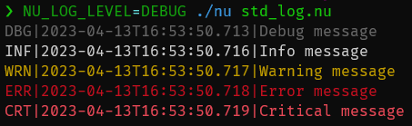

# 标准输出、标准错误和退出码

Nushell 与外部命令互通的一个重要部分，是处理来自外部命令的标准数据流。

其中第一个重要的数据流是 stdout。

## 标准输出流

stdout 是大多数外部应用向管道或屏幕发送数据的方式。如果外部应用在管道中，它发送到 stdout 的数据默认会被 Nushell 接收：

```nu
nu -c 'print hello' | str uppercase
# => HELLO
```

上面把 `nu` 当作外部命令调用，并把它的 stdout 输出流重定向到管道中。有了这个重定向，Nushell 就能把数据传给管道中的下一个命令，这里是 [`str uppercase`](/commands/docs/str_uppercase.md)。

如果没有管道，Nushell 不会做任何重定向，而是让它直接打印到屏幕上。

## 标准错误流

外部应用常用来打印错误信息的另一个常见数据流是 stderr。默认情况下，Nushell 不对 stderr 做任何重定向，这意味着它默认会打印到屏幕上。

但你也可以在需要时把 stderr 传给某个命令或文件：

- 用 `e>|` 把 stderr 传给下一个命令。
- 用 `e> file` 把 stderr 重定向到文件。
- 用 `do -i { cmd } | complete` 来捕获 stderr 消息。

## 退出码

最后，外部命令还有一个"退出码"。这些代码用于提示调用者该命令是否运行成功。

Nushell 通过两种方式之一来跟踪最近完成的外部命令的退出码。第一种方式是使用 `LAST_EXIT_CODE` 环境变量。

```nu
nu -c 'print "something went wrong"; exit 3'
# => something went wrong
$env.LAST_EXIT_CODE
# => 3
```

第二种方式是使用 [`complete`](/commands/docs/complete.md) 命令。

非零的退出码会被视为错误。在脚本中，执行会在失败的那条命令处停止，其后的行不会运行。（在 REPL 中，可以在失败的命令之后单独一行输入 `$env.LAST_EXIT_CODE`，如上所示。）

这同样适用于管道中间的外部命令：如果管道中**任何一个**外部命令失败，整个管道就会失败，即使它后面的命令执行成功了（类似于 Bash 中的 `set -o pipefail`）。此时 `$env.LAST_EXIT_CODE` 会被设为**最右边那个**失败命令的退出码。要自己处理失败，可以使用 [`try`](/commands/docs/try.md)，其 `catch` 闭包会收到一个带 `exit_code` 字段的错误记录；或者用 `complete` 捕获退出码：

```nu
try { ^false | lines } catch {|err| $err.exit_code }
# => 1
```

::: tip
这个管道行为是一个可以关闭的实验性选项，名为 `pipefail`。要关闭它，用 `nu --experimental-options '[pipefail=false]'` 启动 Nushell。
:::

## 使用 [`complete`](/commands/docs/complete.md) 命令

[`complete`](/commands/docs/complete.md) 命令让你可以把外部命令运行到底，并把 stdout、stderr 和退出码一起收集到一个记录中。

如果我们尝试对一个不存在的文件运行外部命令 `cat`，就可以看到 [`complete`](/commands/docs/complete.md) 如何处理这些流，包括被重定向的 stderr：

```nu
cat unknown.txt | complete
# => ╭───────────┬─────────────────────────────────────────────╮
# => │ stdout    │                                             │
# => │ stderr    │ cat: unknown.txt: No such file or directory │
# => │           │                                             │
# => │ exit_code │ 1                                           │
# => ╰───────────┴─────────────────────────────────────────────╯
```

`stderr` 的值以换行结尾，这就是表格中消息后面显示一个空行的原因。

## `echo`、`print` 和 `log` 命令

[`echo`](/commands/docs/echo.md) 命令主要用于*管道*。它返回自己的参数，忽略管道传入的值。通常没什么理由用它，直接把值写出来即可。

相比之下，[`print`](/commands/docs/print.md) 命令把给定的值作为纯文本打印到 stdout。它也可以用来写入标准错误输出。与 [`echo`](/commands/docs/echo.md) 不同，这个命令不返回任何值（`print | describe` 会返回 "nothing"）。由于该命令没有输出，把它与其他命令用管道连接没有意义。

[标准库](./standard_library.md)中有用于以不同日志级别输出消息的命令。例如：

@[code](@snippets/book/std_log.nu)



输出的日志级别可以用 [`NU_LOG_LEVEL`](./special_variables.md#env-nu-log-level) 环境变量设置：

```nu
NU_LOG_LEVEL=DEBUG nu std_log.nu
```

## 文件重定向

如果你想把外部命令的 stdout 重定向到文件，可以用 `out>` 后接文件路径。类似地，可以用 `err>` 重定向 stderr：

```nu
cat unknown.txt out> out.log err> err.log
```

如果你想把 stdout 和 stderr 都重定向到同一个文件，可以用 `out+err>`：

```nu
cat unknown.txt out+err> log.log
```

注意 `out` 可以简写为 `o`，`err` 可以简写为 `e`。所以下面的例子与上面的等价：

```nu
cat unknown.txt o> out.log e> err.log

cat unknown.txt o+e> log.log
```

此外，文件路径可以使用任何表达式，只要它的值是字符串：

```nu
use std
cat unknown.txt o+e> (std null-device)
```

分号遵循既定的管道行为。在下面的例子中，第一个外部命令打印到 stdout，第二个外部命令的 stdout 成为括号子表达式的输出，并被管道传入 `test.txt`。

```nu
(nu -c 'print hello'; nu -c 'print world') o> test.txt
# => hello
open test.txt
# => world
```

要合并输出，请把它们放进一个块并用 `do` 执行：

```nu
let text = "hello\nworld"
do { $text | head -n 1; $text | tail -n 1 } o> out.txt
open out.txt
# => hello
# => world
```

这种外部命令的行为与 Nushell 原生表达式不同——后者的第一条命令的 stdout 会被丢弃：

```nu
('hello'; 'world') o> test.txt
open test.txt
# => world
```

## 管道重定向

如果外部命令后面跟的是普通管道 `|`，它会把该外部命令的 stdout 重定向为下一个命令的输入。若要改为重定向该外部命令的 stderr，可以使用 stderr 管道 `err>|` 或 `e>|`：

```nu
nu -c 'print -e error' e>| str uppercase
# => ERROR
```

当然也有对应的管道用于合并 stdout 与 stderr，即 `out+err>|` 或 `o+e>|`：

```nu
nu -c 'print output; print -e error' o+e>| str uppercase
# => OUTPUT
# => ERROR
```

::: note
由于失败的外部命令会让整个管道失败（参见[退出码](#退出码)），以错误退出的命令其被重定向的输出可能会丢失。例如，`cat unknown.txt e>| str uppercase` 什么也不打印，因为 `cat` 以退出码 1 结束。当你同时需要失败命令的输出和退出码时，请使用 [`complete`](#使用-complete-命令)。
:::

与文件重定向不同，管道重定向不适用于表达式内的所有命令。相反，只有表达式中的最后一个命令会受到影响。例如，在下面的代码片段中，只有第二个 `nu` 命令的 stdout 和 stderr 会被管道重定向，因此只有它的输出被转换成大写。

```nu
(nu -c 'print -e one'; nu -c 'print -e two') o+e>| str uppercase
# => one
# => TWO
```

## 丢弃输出

[`ignore`](/commands/docs/ignore.md) 命令会丢弃前一个命令的输出。默认情况下，它会消耗 stdout，并让外部命令的 stderr 照常显示到屏幕上。使用 `--stderr` 可以改为消耗 stderr，同时使用两个标志则可以完全静默该命令：

```nu
nu -c 'print output; print -e error' | ignore
# => error
nu -c 'print output; print -e error' | ignore --stderr
# => output
nu -c 'print output; print -e error' | ignore --stdout --stderr
```

`ignore` 也会忽略非零的退出码，所以 `^false | ignore` 不会让脚本中断。加上 `--show-errors` 可以让错误继续抛出并设置 `$env.LAST_EXIT_CODE`。

## 检查是否为终端

脚本可能只希望在有人看着的时候才打印颜色或进度输出。[`is-terminal`](/commands/docs/is-terminal.md) 用于检查 Nushell 进程的 stdin、stdout 或 stderr 是否连接到终端（`--stdin`、`--stdout` 或 `--stderr`）。例如，子 `nu` 进程在输出直接到屏幕时能看到终端，但在输出被管道传给另一个命令时就看不到了：

```nu
nu -c 'is-terminal --stdout'
# => true
nu -c 'is-terminal --stdout' | str trim
# => false
```

## 原始流

在 Nushell 中，stdout 和 stderr 都表现为"原始流"。这些流是字节流，而不是 Nushell 内部命令所使用的结构化数据。

因为字节流可能很难处理，特别是考虑到使用输出作为文本数据是很常见的，Nushell 试图将原始流转换为文本数据。这使得其他命令可以拉取外部命令的输出，并接收它们可以进一步处理的字符串。

Nushell 试图用 UTF-8 转换为文本。如果在任何时候转换失败，流的其余部分就会被假定为始终是字节。

如果你想对字节流的解码有更多控制，可以使用 [`decode`](/commands/docs/decode.md) 命令。[`decode`](/commands/docs/decode.md) 命令可以插在管道中外部命令（或其他产生原始流的命令）之后，并根据你给它的参数来处理字节解码。例如，你可以这样解码 shift-jis 文本：

```nu
0x[8a 4c] | decode shift-jis
# => 貝
```
